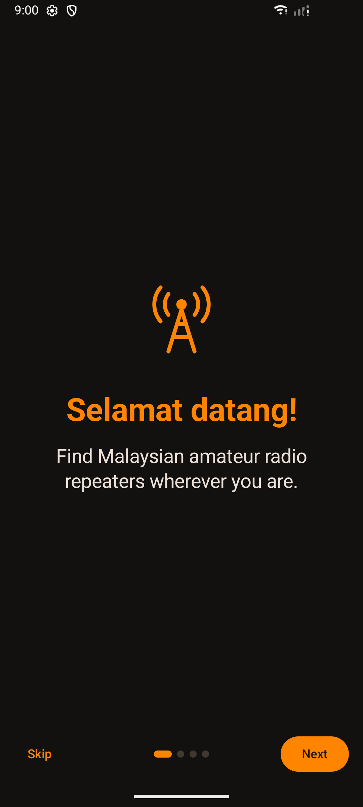
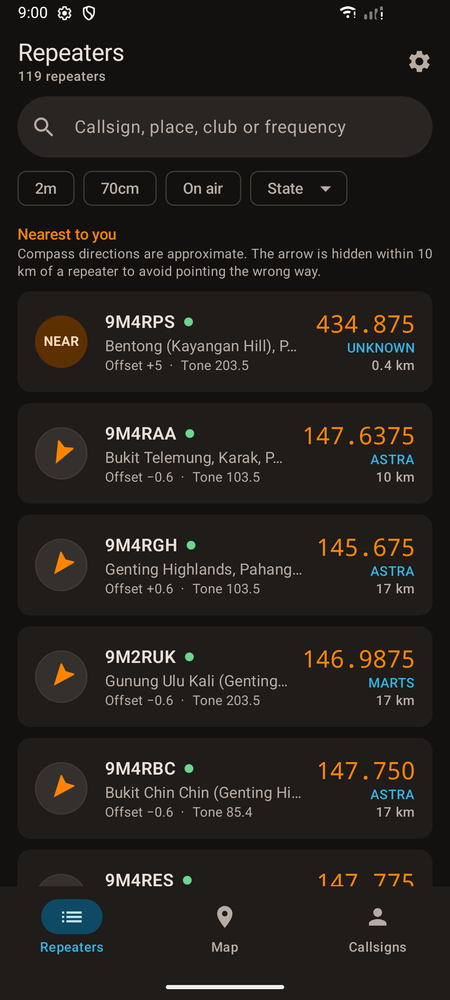
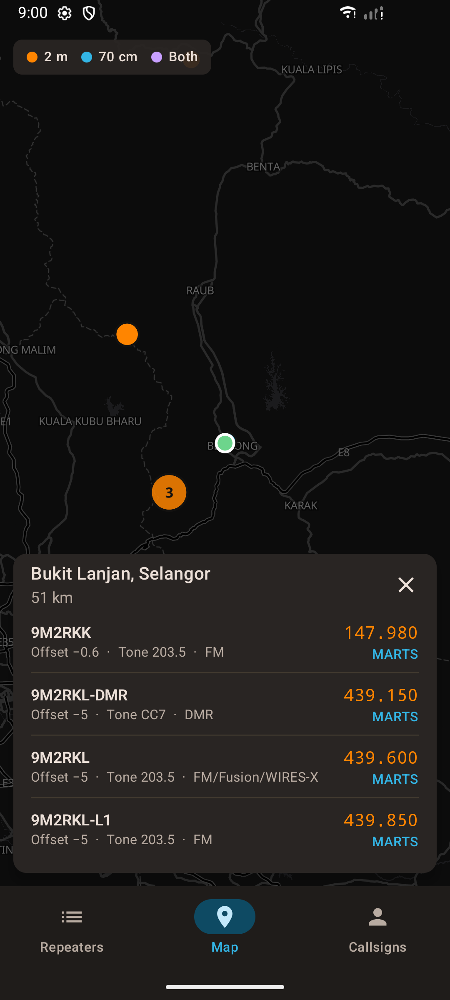
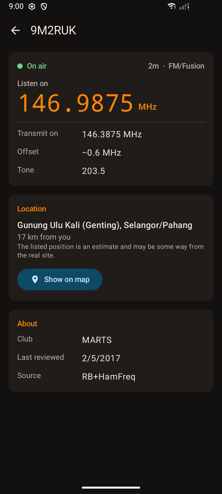

# Repeater.MY

Repeater.MY for Android: a Malaysian amateur radio repeater finder.

It lists the country's 2 m and 70 cm repeaters, sorts them by distance from
where you are, and keeps working without a signal, so it is as useful on a
jungle trail as on the highway.

> **Status:** this branch is a ground-up rewrite in Kotlin for current Android
> versions. The version on Google Play is still the previous release (2.3.7).

## Screenshots

<p>
  
  
  
  
</p>

## Features

- **Nearest first.** Repeaters sorted by distance from your position, with a
  compass arrow pointing towards each one. The arrow is hidden within 10 km,
  where the listed positions are too coarse to point with.
- **Map.** Every repeater with known coordinates on an OpenStreetMap-based
  map, colour-coded by band and clustered when zoomed out. Tap a pin for the
  frequencies at that site.
- **Works offline.** The repeater list is stored on the phone after the first
  start. Map areas you have already viewed stay available, and a built-in
  outline of Malaysia is shown when no map tiles are.
- **Search and filters.** Find a repeater by callsign, place, club or
  frequency, and narrow the list by band, state or on-air status.
- **Repeater details.** Listen and transmit frequencies, offset, tone, mode,
  club, status and source notes, laid out for programming a radio.
- **Callsign lookup.** Search the Malaysian amateur callsign directory by
  callsign or holder name.
- **No location? No problem.** Pick a place from a list covering every state
  instead of sharing your position.

## Privacy

- No account, no ads, no analytics.
- Location is optional, used only while the app is open, and never leaves the
  phone.
- The app connects to the internet only to download the public repeater and
  callsign lists, and map tiles.
- Callsign searches run on the phone.

## Requirements

- Android 8.0 (API 26) or newer.
- An internet connection for the first start, to download the data.

## Downloads

- Google Play: [net.mypapit.mobile.myrepeater](https://play.google.com/store/apps/details?id=net.mypapit.mobile.myrepeater)
  (currently the previous release)

## Building

You need JDK 17 or newer and the Android SDK (platform 37).

```bash
./gradlew assembleDebug
```

```bash
./gradlew testDebugUnitTest
```

The debug APK is written to `app/build/outputs/apk/debug/`.

## Project layout

| Path | Contents |
|---|---|
| `app/` | The Kotlin app: Jetpack Compose, Room, MapLibre |
| `legacy/` | The original Java app, kept for reference only |
| `screenshots/` | Images used in this README |

## Accuracy

Repeater positions are estimates and can be some way from the real site.
Always confirm frequencies and tones on air.

## Credits

- Map data © [OpenStreetMap](https://www.openstreetmap.org/copyright)
  contributors, with tiles served by [OpenFreeMap](https://openfreemap.org/).
- Map rendering by [MapLibre](https://maplibre.org/).
- The offline outline is derived from [Natural Earth](https://www.naturalearthdata.com/)
  (public domain).

## Licence

GNU General Public License v3.0. See [LICENSE](LICENSE).
